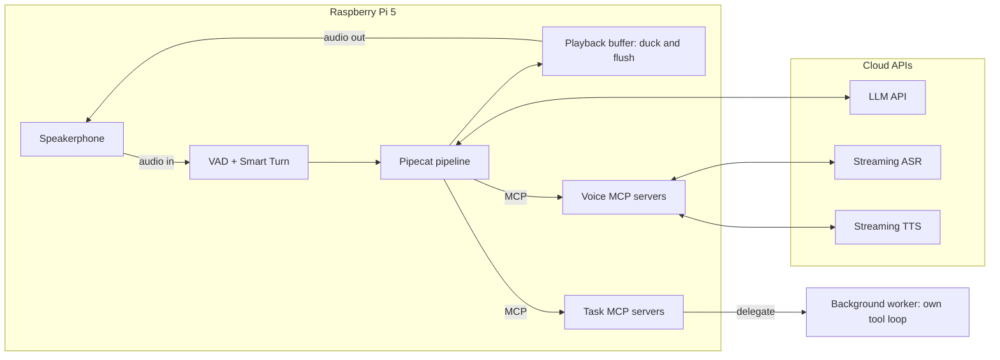
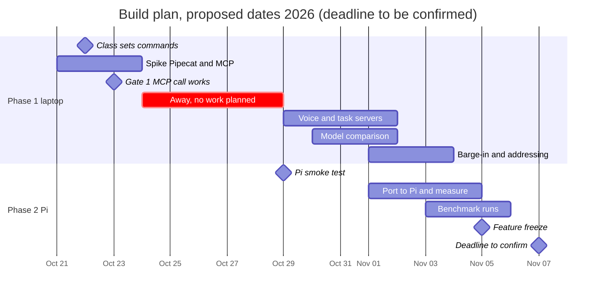

# ME3 Architecture Review: Full-Duplex Voice Agent on Raspberry Pi 5

Revision 2, Oct 21, 2026 · Quiel Quiwa

This revision folds in the verification research on Pipecat, providers, licences, and benchmarks. The list of what changed from revision 1 is at the end of the Decisions section. Items marked unverified come from third-party pages or were not checked.

## Decisions

We build a cascaded, streaming voice agent on Pipecat 1.x, with ASR and TTS wrapped as MCP servers that control the audio rather than carry it, and keep onit off the latency-critical path. Four of the seven choices below are yours from the guide questions; the other three follow from the research.

| Decision | Choice | Rejected | Why |
| --- | --- | --- | --- |
| Paradigm | Cascaded: VAD, streaming ASR, LLM, streaming TTS, plus MCP tools | Native full-duplex models (Moshi, PersonaPlex, Nemotron VoiceChat) and speech-to-speech APIs as the main path | Tool reliability and any-MCP-tool support; nothing heavy on the Pi; Nemotron needs 80 GB of GPU memory and tool-calls at 33% pass@1 (third-party reported). Kept as the quality reference in the benchmark. |
| Voice runtime | Pipecat 1.x, running on the Pi | LiveKit Agents; onit as the voice brain | Transport-agnostic pipeline with a local audio transport, Smart Turn, configurable user-turn strategies, and a native MCP client (`MCPClient`, verified in Pipecat's own docs). No media server in the loop. Your choice. |
| MCP scope | Control plane only: listen, speak, stop, duck, and event tools over MCP; audio flows on a local side channel | Audio chunks through MCP calls | A blocking request and response tool cannot be cancelled in tens of milliseconds. Your choice. |
| Addressing | No wake word; the agent judges whether it is being addressed | Wake word after idle | Matches the spec's spirit. This is the riskiest choice, so it gets its own section and a config flag to fall back. Your choice. |
| LLM | Commercial API for conversation, compared head to head against OpenRouter and Ollama Cloud models, under about $20 of development spend | DGX Qwen as the default | Time to first token is the biggest block in the latency budget and the shared DGX cluster is the known slow part. Your choice, plus the comparison you asked for. |
| Starting stack (to be confirmed by the comparison) | ASR: Deepgram Flux. TTS: Cartesia Sonic on a Pro plan. LLM: Groq gpt-oss-20b, escalating to gpt-oss-120b or Claude Haiku 5.5. VAD: Silero | Gemini 3.5 Flash-Lite on the live path; TEN VAD | Word-timestamped TTS is what makes context truncation work; the Groq models are fast and very cheap; Gemini 3.5 Flash-Lite measured 5 to 8 s to first token with thinking (Artificial Analysis); TEN VAD's licence bars competing use. Nothing is bought until you approve. |
| Complex task | Delegated to a background worker agent through an MCP tool that returns a task id at once | Running the task inside the voice loop | The voice loop must keep talking and listening while work runs, which is the asynchronous behavior raised in the class chat. |

### About onit

You asked for better tools than onit because it is slow on the shared DGX. Three points:

- The slowness is most likely the model endpoint it is pointed at, not onit itself, but nobody has measured that, and its docs give no latency figure. Its setup takes an endpoint URL, key, and model name, so it can be pointed at a fast commercial endpoint (for example Groq) instead of the DGX. The plan times it against a stub LLM to separate its own overhead from the endpoint.
- Pipecat takes over the job onit would have done on the voice path (the loop that decides which tool to call). Onit stays useful for the one long task such as building a website, where its shell, file editing, and web search tools matter and a few extra seconds do not. It is a small project (about 10 stars) with no documented programmatic API, so it sits behind our `delegate` MCP server and runs as a subprocess in a per-task sandbox directory. Hermes Agent (MCP both ways, 70+ tools) is an alternative worker, but a review reports 15,000 to 20,000 input tokens of fixed overhead per call, which makes it a poor fit for anything latency-bound.
- **Nov 3, 2026: OnIt is dropped as the worker.** If `delegate` is built, its worker is our own tool loop on a model chosen then (Haiku 5.5, a model through OpenRouter, or one served by Ollama), using the workspace tools behind the tool policy. Only OnIt's command policy table stays, vendored in `servers/vendor/` for the shell guard (ADR-024).
- CrewAI is a multi-agent orchestration framework with MCP integration announced in its community forum. It has no audio layer and adds LLM calls, so it does not belong on the voice path. It could be a worker, but onit's built-in shell and file tools fit the website task better.

Pipecat's MCP support is now verified from its own documentation: `MCPClient` supports stdio, SSE, and streamable HTTP, and `register_tools(llm)` converts MCP tool schemas into LLM function calls. Two caveats remain. `MCPClient` has no documented way to surface server notifications (such as `speech_started` or `played_up_to`) as pipeline events, so we need our own bridge (see the MCP section). And the pull request that widens MCP SDK compatibility says only the streamable HTTP path is integration-tested. Gate 1 therefore tests a real spoken tool call over both stdio and HTTP.

### What changed in this revision

1. Pipecat MCP support verified from primary docs, with the notification gap found.
2. `MinWordsInterruptionStrategy` was removed in Pipecat 1.0.0. Interruptions are configured through user-turn strategies, and duck-then-decide is custom code.
3. The duck target moves from under 50 ms to under 100 ms of VAD onset, and a keyword allowlist handles one-word interruptions.
4. Pipecat has no echo cancellation. The plan now names the options and schedules the test early in Phase 2.
5. The model shortlist changed. Gemini 3.5 Flash-Lite is off the live path, and unverified models are marked as such.
6. TEN VAD is excluded for its licence. Silero is the VAD.
7. Spotify is demo only, because its terms and quotas rule it out for a product.
8. Full-Duplex-Bench is CC BY-NC 4.0, and v3 (tool use) is added to the benchmark plan.
9. The budget plan is rebuilt around about $20 of proposed cash, with a Cartesia credit caveat.
10. New sections: Licences and IP, and Improvements to test.

## At a glance

The Pi holds the audio device, VAD, the Pipecat loop, and the MCP servers. The voice servers hold the ASR and TTS connections and the LLM is called from Pipecat, so a model can be swapped without touching the loop. Audio frames travel on a local side channel, and MCP carries only commands and events. The one long task goes to a worker over `delegate`, so the loop keeps listening while it runs.

## Two phases: laptop first, then the Pi

Phase 1 builds and debugs the whole agent on your MacBook Air. Phase 2 moves it to the Pi and measures it. The aim is that the move is a config change plus fixes, not a rewrite, so the laptop version is built as if it were already on the Pi.

### Rules that keep the move cheap

1. **One entry point, two profiles.** The same command starts the agent with `--profile laptop` or `--profile pi`. A profile sets the audio devices, sample rate, buffer size, and which providers are used. Nothing else differs.
2. **Hardware behind one small interface.** Microphone input and speaker output go through one `AudioIO` adapter, with device names taken from the profile. Pipecat's local audio transport uses PyAudio (PortAudio), which needs the portaudio system package on both machines. VAD and Smart Turn run through the same ONNX runtime on both machines.
3. **Only what will run on the Pi runs locally.** On the laptop, VAD and Smart Turn run locally and everything else is an API call, exactly as planned for the Pi. No local model goes into the laptop build that the Pi could not run.
4. **No laptop-only dependencies.** Pipecat needs Python 3.11 or newer. Use uv to install the same Python minor version on both machines (a third-party Pi 5 build ran Python 3.13 on Debian 13), pin dependencies in a lock file, avoid macOS-only audio libraries, and use no absolute paths. If your Air is Apple silicon, both machines are 64-bit ARM, and a Linux ARM container on the Mac is a cheap way to check the Pi install before touching the Pi.
5. **Same logs, same clocks.** The benchmark's event log works on both machines from day one, so Phase 1 already produces real stage timings. Laptop numbers are not Pi numbers (the Pi will be slower on VAD and Smart Turn), but the network and provider stages carry over.
6. **Headphones in Phase 1.** A laptop speaker feeding its own microphone creates echo that a speakerphone handles differently. Headphones let the interruption logic be tested without echo, and the speakerphone and echo are tested in Phase 2.

### What each phase can and cannot show

| Phase | Where | What it shows | What it cannot show |
| --- | --- | --- | --- |
| 1 | Laptop with headphones | The loop, tool calls, barge-in logic, model comparison, cost per minute | Pi timings, speakerphone echo, heat and throttling, behavior on a weak network |
| 2 | Pi with the speakerphone | Stage latencies on the target hardware, echo, power and network behavior, the final benchmark | Behavior on any other hardware |

## Voice loop and barge-in

The loop has to do two things quickly: answer within about a second of the user finishing, and go silent within about 300 ms of the user cutting in. The first is mostly the LLM and TTS; the second is mostly the Pi and its audio buffer, which is why it is the part we control.

### Normal turn

1. VAD marks speech onset on the Pi; audio streams to ASR from that moment. With Pipecat's default Silero settings speech is declared after about 192 ms (six 32 ms windows), so we lower `start_secs` to about 0.064 to 0.1 and tune it against false triggers.
2. Partial transcripts arrive while the user speaks; nothing is sent to the LLM yet.
3. The VAD sees about 0.2 s of silence (`stop_secs`), then Smart Turn judges the last few seconds of audio as complete or incomplete. Smart Turn v3 is an 8M-parameter model that scores up to the last 8 seconds. Deepgram Flux has its own end-of-turn signal, so we A/B the two on our own recordings.
4. On "complete", the final transcript goes to the LLM with the conversation history and tool list.
5. LLM tokens stream to TTS sentence by sentence; the first audio chunk reaches the speaker as soon as TTS returns it.

### Barge-in (user speaks while the agent talks)

Pipecat 1.x decides interruptions through configurable user-turn strategies on the user aggregator (`user_turn_strategies`). The older interruption-strategy classes, including `MinWordsInterruptionStrategy`, were deprecated in 0.0.99 and removed in 1.0.0, and stale `allow_interruptions=` arguments are silently ignored. By default, speech detected while the bot talks interrupts it: the LLM and TTS stop and the output transport drops its buffered audio. There is no built-in pause or duck mode. `MinWordsUserTurnStartStrategy` can require N words first, but that makes the stop wait for the transcript and would also stop a one-word "stop" or "no" from interrupting. A cough or "mm-hmm" should not cancel a reply, and waiting for words costs hundreds of milliseconds. The design below is a proposal that needs a small custom processor:

1. **Duck on onset.** A processor placed just before the transport output scales the agent's audio frames down (about 0.3) when the VAD reports speech during playback. The target is a duck within 100 ms of VAD onset. The TTS and LLM streams keep running for now.
2. **Allowlist first.** A short keyword allowlist (stop, wait, no, cancel, pause) interrupts immediately regardless of word count.
3. **Decide within about 0.5 s.** If the utterance ends in under 1 s with fewer than 2 words (the Full-Duplex-Bench v1 definition of a backchannel), restore the volume and continue. If it runs longer or is a command, treat it as an interruption.
4. **Cancel on interruption.** Use the aggregator's interruption path, which stops the LLM and TTS and drops buffered output audio.
5. **Truncate the context.** Pipecat commits only the words actually spoken when the TTS service returns word timestamps (Cartesia, ElevenLabs WebSocket, Rime, and a few others). It cannot with Deepgram Flux TTS, which sends no playback offset (Pipecat issue 5605). Keep sentence aggregation, because token aggregation has committed unspoken text on interruption (issue 5426).

The class names and timings above come from Pipecat's documentation and issue tracker plus a third-party analysis of version 1.12, so verify them against the installed version. The pause-then-decide step is also what makes the v1.5 "user backchannel" scenario pass, since that scenario expects the agent to keep talking. LiveKit's agent framework truncates with playback timestamps too, which is described in an outside DeepLearning.AI course, not in Prof's lectures.

### Echo and the speakerphone

Pipecat has no built-in echo cancellation (there is an open feature request). Without it, VAD fires on the agent's own voice and the agent interrupts itself. In order of preference:

1. A speakerphone with hardware echo cancellation, because the reference signal is the device's own loudspeaker. The Jabra Speak2 40 lists acoustic echo cancellation and sold for about $165 at B&H; whether the VCM plan's Anker PowerConf S3 class device cancels echo well enough is not verified.
2. PipeWire's `libpipewire-module-echo-cancel` with the WebRTC backend (or PulseAudio's `module-echo-cancel`), which costs Pi CPU and needs tuning.
3. An RMS gate while the bot speaks, as a last resort, since it also blocks soft barge-in.

Headphones in Phase 1 hide the problem completely, so the echo test is scheduled early in Phase 2, not at the end. A third-party Pipecat 1.3 build on a Pi 5 used a ReSpeaker array with hardware echo cancellation plus such a gate.

### Latency budget (proposed targets)

The reference range comes from an outside source, the DeepLearning.AI voice agent course, which uses LiveKit's figures. It is not part of Prof's lectures, so we treat it as context for ideas, not as ground truth. The targets are ours and are hypotheses until measured, first on the laptop and then on the Pi.

| Stage | Outside course range | Our target | Notes |
| --- | --- | --- | --- |
| VAD speech onset | about 20 ms | 100 ms or less to start a duck | Silero on the Pi; Silero's default declares speech after about 192 ms, so `start_secs` is lowered. TEN VAD is excluded for its licence. |
| End-of-turn decision | about 100 ms | 250 to 400 ms after speech ends | 0.2 s VAD silence plus Smart Turn (12.6 to 94.8 ms on cloud CPUs, 59.8 ms on one ARM vCPU; no Pi 5 figure published, so expect roughly 60 to 120 ms, to be measured). A third-party analysis puts Pipecat's own release time near 350 ms. |
| ASR finalization | 100 to 500 ms | 150 ms | Streaming ASR already holds most of the text when the turn ends |
| LLM time to first token | 220 to 500 ms | 350 ms | The main variable in the model comparison. Groq gpt-oss-120b showed about 234 ms median on OpenRouter (third-party). |
| TTS time to first byte | 100 to 450 ms | 150 ms | Start TTS on the first sentence, not the full reply |
| Network round trips from the Pi | not in slides | measure | Each hop to ASR, LLM, and TTS |
| **End-to-end response** | **540 ms best, 1.6 s worst** | **p50 under 1.0 s, p95 under 1.5 s** | 1.5 s is the human-like repair bar in Full-Duplex-Bench v1.5. Measured acoustically, from the end of speech to the first non-silent output sample. |
| **Duck** | n/a | **within 100 ms of VAD onset** | A single 32 ms window would fire on echo, so the duck waits for a short confirmation |
| **Stop latency** | n/a | **p50 under 300 ms, flush under 50 ms** | For reference, GPT-4o Realtime measured 0.23 s in v1.5 |

### Waiting phrase (approved, ADR-009)

Tool turns need a second LLM call, and the budget above has no line for it. A short local clip ("One sec") from the pre-synthesised phrase cache plays when a tool call starts, or when no reply audio has started about 600 ms after end of turn (a hypothesis to tune). It plays once per turn at most, stops on interruption, never enters the LLM context, and never plays for `stay_silent` or in IDLE. It shortens the silence but does not count toward the targets: the log records `filler_audio_out` separately, and the headline stays first answer audio. Nov 4, 2026 (ADR-033): on by default, five clips rotate, the timer is 1500 ms, only slow tools trigger it on start, and the prompt tells the model not to say a waiting phrase itself. Reply templates stay off.

## MCP servers and tool contracts

Two voice servers give the harness its ears and mouth, and seven task servers cover the ten ME2 commands plus delegation. All are written with FastMCP (the Python SDK in Prof's Agents deck) and run on the Pi, so the spec's "you build and run your MCP servers" is met, while the models behind ASR and TTS are commercial APIs.

### Voice servers (control plane)

**Nov 4, 2026: built as thin servers (ADR-032).** `voice-listen` holds the Flux stream and `voice-speak` holds the Cartesia stream, each with its own key and cap check. The provider's messages travel on a Unix socket per stream, and MCP carries `listen`, `speak`, `stop`, and the voice events. Playback, ducking, and echo cancelling stay in the harness, next to the speaker, so `duck`, `unduck`, and `interrupt` are not server tools. Select them with `stt=voice_listen,tts=voice_speak`. The table below is the original design.

Audio frames travel on a local side channel between the audio device, VAD, and these servers (a Unix socket or shared memory; the choice is a spike). MCP carries only commands and events, which stay small and cancellable.

| Server | Tools | Events it pushes | Backing service |
| --- | --- | --- | --- |
| `voice-listen` (ASR) | `start_listening`, `stop_listening`, `set_vocabulary`, `status` | `speech_started`, `speech_ended`, `transcript_partial`, `transcript_final` | Streaming ASR over WebSocket (Deepgram Flux first, with Nova-3 as the alternative; Cartesia Ink and ElevenLabs Scribe as swap-ins) |
| `voice-speak` (TTS) | `speak`, `append_text`, `pause`, `resume`, `stop`, `duck(gain)`, `unduck`, `interrupt(kind)`, `status` | `playback_started`, `played_up_to` (utterance id, word index, and millisecond offset), `playback_finished` | Streaming TTS (Cartesia Sonic first, for word timestamps; Aura-2 as the free-credit fallback, whose word-timestamp support in Pipecat is unverified) |

`duck`, `unduck`, `pause`, `resume`, and `played_up_to` are what make the duck-then-decide barge-in and the context truncation possible. Putting duck and unduck in the speak server means the harness only decides and the server acts at the audio buffer. Pipecat's own STT and TTS services would normally sit in this position, so our servers are wrapped in thin Pipecat service classes that call them. That extra hop is a cost to measure on loopback before we trust it.

**The notification bridge is the largest custom piece.** Pipecat's `MCPClient` turns MCP tools into LLM function calls, but I found no documented way for it to deliver server notifications as pipeline events. A `VoiceMCPBridge` service therefore talks to the voice servers through the raw MCP Python SDK `ClientSession`, with a message handler that turns notifications into Pipecat frames. It should be spiked first. Pin the versions deliberately: the current Pipecat is 1.13.0 (Oct 19, 2026), FastMCP is 4.1.x, and the MCP Python SDK is 2.x (MIT). Pipecat pull request 5624 widens MCP SDK support to 2.x and notes that without it streamable HTTP breaks on SDK 2.x; I did not verify that it is merged, so check, or pin `mcp<2`.

### Task servers for the ME2 commands

| Server | Tools | Commands covered | Backing service and notes |
| --- | --- | --- | --- |
| `music` | `play`, `pause`, `next`, `previous`, `set_volume`, `search_and_play` | Play music, media control | Spotify Web API (you have Premium); needs a registered app and token refresh. Demo only: its terms and quotas rule it out for a product (see Licences and IP). |
| `lights` | `set_power`, `set_brightness`, `set_color` | Control lights, dim and color | Xiaomi bulb you own; local control support per model is unchecked, so the driver is a spike |
| `clock` | `set_timer`, `set_alarm`, `list`, `cancel` | Timer, alarm | Local scheduler on the Pi with a persistent store; announces through `voice-speak` when due |
| `thermostat` | `get`, `set_target` | Adjust thermostat | A realistic mock with state, since no thermostat hardware is listed (same approach as the mocked "call mom" in the VCM plan) |
| `notes` | `add_reminder`, `list_reminders`, `add_to_list`, `read_list` | Reminders and lists | Local SQLite |
| `comms` | `call`, `send_message` | Calls and messaging | Mock first; Bluetooth to the iPhone is the Tier 2 stretch from the VCM plan |
| `knowledge` | `web_search`, `fetch_page` | Ask a question or search | A search API; provider not yet chosen |
| `delegate` | `start_task`, `task_status`, `task_result`, `cancel_task` | The random complex task | Returns a task id at once; a worker loop (our own, on a model not yet chosen) runs it in the background with the workspace tools and the voice agent reports back when it finishes. We use our own task ids and polling, not the MCP tasks extension (SEP-2663), because Pipecat's client is unlikely to support it (unverified). |

### Rules for all servers

- **Fast tools return in milliseconds and slow tools return an id.** Anything that can take more than a second to finish (delegation, calls, long searches) starts a job and reports through an event, so the voice loop never blocks.
- **Small schemas.** Every tool description is sent on every LLM call. Fewer than about 25 tools with one-line descriptions keeps the prompt near the 3,000 tokens assumed in the cost model; this is a target to check.
- **Stdio for local servers, streamable HTTP for the remote worker.** The Agents deck lists stdio as the default for local tools and streamable HTTP for web deployments.
- **Confirmation for actions that cost money or reach other people** (calls, messages, purchases), per the least-privilege point in the Agents deck. A spoken yes is cheap and one wrong call is not.
- **Log every tool call** with a timestamp, arguments, result, and duration. The benchmark reads these logs.
- **Annotate every tool** with the MCP hints `readOnlyHint`, `destructiveHint`, `idempotentHint`, and `openWorldHint`. The spec treats them as hints that clients should not trust from untrusted servers, so the harness enforces the policy, not the server.
- **Destructive tools default to mocks** and go through a harness-enforced undo window of about 5 s (a spoken "cancel" stops the call before it commits).
- **Expect session expiry.** FastMCP 4.1 expires HTTP sessions after 30 minutes idle by default, so clients must reconnect.

### Tool policy (approved, ADR-009)

The rules above are enforced by `harness/tool_policy.py`, between `MCPClient` and the LLM. Defaults come from the MCP hints and `configs/tool_policy.yaml` can override them: read-only and non-destructive tools run at once, destructive tools wait out the 5 s undo window, destructive open-world tools also need a spoken yes, and tools with missing hints need a spoken yes. Each tool has a `permission` (`auto`, `confirm`, `disabled`), `undo_s`, and `timeout_s`. Disabled tools are removed from the schema. The microphone is never blocked during a tool; only the commit step is protected once the undo window ends. Spoken "cancel" must work in both barge-in modes.

## No wake word: deciding when it is being addressed

Without a wake word the agent must decide on every utterance whether it is being spoken to, and a wrong guess costs money as well as annoyance. Full-Duplex-Bench v1.5 shows the problem is real: GPT-4o Realtime answered side conversations 91% of the time and background speech 93% of the time, while Amazon's Nova Sonic ignored them (0.90 and 0.98 Resume rates).

### Three filters, cheapest first

1. **Acoustic gate on the Pi.** Require speech to rise a set margin above the measured room noise floor for a minimum duration before it counts. Far-field talk (the v1.5 background-speech scenario) is quieter and more reverberant at a table-top speakerphone than someone talking to it. A short ring buffer (300 to 500 ms of pre-roll) is sent upstream only when the gate opens, so the first words are not lost. This costs no API spend.
2. **Conversation state.** Two states, with no wake word in either. In ACTIVE (the agent spoke or was spoken to in the last N seconds), any speech continues the dialogue. In IDLE, the bar is higher: the utterance must look like a request or question, and short fragments are dropped. N is a parameter to tune; the class chat suggested a similar idle interval.
3. **Semantic check in the same LLM call.** The model gets a one-line rule and a `stay_silent` tool; when the transcript is clearly not addressed to it ("pass me the salt"), it calls `stay_silent` and no TTS is generated. This adds no extra round trip. A cheaper model can pre-screen in IDLE only, if the main model's per-call cost matters.

The agent can also use cues in the text, such as direct questions, imperative verbs about its tools, or a name if we choose to give it one. A name is not a required wake word, only another cue, and it keeps the filter honest.

### What a false trigger costs

An always-open microphone with streaming ASR bills for speech the VAD lets through. At Deepgram Nova-3's regular $0.0077 per minute, eight hours of ambient speech in a busy room is about $3.70 per day for ASR alone, before any LLM or TTS call. Streaming 24 hours a day at Flux's promotional $0.0065 per minute would be about $9.36 per device per day, which is why gating ASR with the VAD is the most important cost control. Four guards follow from that:

- A daily spend cap in the harness that mutes the agent and says so when reached.
- A mute switch (physical button or voice command) and a visible indicator, since a room full of people is being streamed to a cloud ASR. Anyone present should know.
- A config flag `require_wake_after_idle` that restores your fallback (a wake word after idle) without code changes, kept off by default and used during development when the room is noisy.
- No audio stored, and a mute that stops the mic before the cloud. `docs/privacy.md` lists what is built.

### How we test it

| Test | Source | Pass bar (proposed) |
| --- | --- | --- |
| Resume rate on talking-to-others and background speech | Full-Duplex-Bench v1.5 scenarios, replayed into the Pi | At or above 0.90 on both, which matches the best commercial result in the paper (Nova Sonic) |
| Resume rate on human backchannels | v1.5 backchannel scenario | At or above 0.90 |
| False triggers per hour of ambient speech | Our own recording of a normal room (TV, conversation) played into the mic | Under 1 per hour; the exact bar is a team decision |
| Missed requests per 100 real requests | Scripted commands, including quiet and accented speech | Under 3, the error target from the VCM exercise |
| Spend per hour of ambient audio | Provider dashboards | Within the daily cap with margin |

## Model comparison under $20

Testing eleven candidate LLMs on the same 40-turn tool-calling set, plus 20 non-addressed utterances, costs about $2 in total, so the comparison is cheap and the $20 ceiling is spent on live voice sessions, not on model tests. All prices below are list prices from the pages named, fetched Oct 20 to 21, 2026 and rechecked in the verification pass (many through third-party aggregators), and none of the speed or quality claims are measured by us yet. Nothing is paid for until you approve it.

### Candidates

Verification changed the list. Groq's gpt-oss models and Claude Haiku 5.5 have the best evidence for a voice path. Gemini 3.5 Flash-Lite is off the live path because Artificial Analysis measures 7.75 s to first token with thinking (one hands-on test reports 1.2 s, so the sources conflict). The models with no verified data are kept in the test but are not ranked.

| Model | Reached through | Input and output per 1M tokens | Status after verification | Source |
| --- | --- | --- | --- | --- |
| Groq gpt-oss-20b | Groq | $0.075 and $0.30 | Shortlist 1, default fast path. About 1,000 tokens per second per Groq; prices as listed Oct 16, 2026 (third-party). Free tier: 30 requests per minute, 1,000 per day. | [Groq](https://console.groq.com/docs/models), [Flexprice](https://flexprice.io/pricing-index/groq) |
| Groq gpt-oss-120b | Groq | $0.15 and $0.60 | Shortlist 2, for multi-step tool calls. About 500 tokens per second; median time to first token 234 ms on OpenRouter (third-party, Sep 2026), though another source reports 0.71 s with reasoning. | [Groq](https://console.groq.com/docs/models), [Klymentiev](https://klymentiev.com/blog/groq-pricing) |
| Claude Haiku 5.5 | Anthropic API | $0.10 and $0.50 (prompts up to 100K tokens; 5x above) | Shortlist 3, quality and tool-reliability fallback. Released Oct 7, 2026; cache reads $0.01 per 1M. Time to first token not verified. | [Anthropic](https://platform.claude.com/docs/en/about-claude/pricing), [MarkTechPost](https://www.marktechpost.com/2026/10/07/anthropic-releases-claude-haiku-5-5-a-small-model-with-1m-context-priced-at-0-10-per-million-input-tokens/) |
| Gemini 3.1 Flash-Lite | Google API | $0.25 and $1.50 | Shortlist 4, third-vendor failover with thinking disabled. Price is aggregator-reported. | [Google](https://ai.google.dev/gemini-api/docs/pricing) |
| Gemini 3.5 Flash-Lite | Google API | $0.30 and $2.50 | Off the live path (slow first token with thinking). Kept only as a baseline. | [Artificial Analysis](https://artificialanalysis.ai/models/gemini-3-5-flash-lite) |
| GPT-5 mini | OpenAI API | $0.25 and $2.00 (aggregator-reported) | Not yet benchmarked | [BenchLM](https://benchlm.ai/llm-pricing) |
| Mercury 3 (Inception) | OpenRouter | $0.10 and $0.35 | Not yet benchmarked. Diffusion-based, so a different speed profile. | [OpenRouter](https://openrouter.ai/models?supported_parameters=tools&order=pricing-low-to-high) |
| DeepSeek V4.1 Flash | OpenRouter, Ollama Cloud | $0.07 and $0.50 on OpenRouter; $0.30 and $1.20 on Ollama Cloud | Not yet benchmarked. The two listings differ and may be different snapshots. | [OpenRouter](https://openrouter.ai/models?supported_parameters=tools&order=pricing-low-to-high), [Ollama](https://ollama.com/search?c=tools&c=cloud) |
| GLM 5.3 Flash | Ollama Cloud | $0.15 and $0.50 | Not yet benchmarked | [Ollama](https://ollama.com/search?c=tools&c=cloud) |
| MiniMax M3.1 Flash | Ollama Cloud, OpenRouter (free tier) | $0.15 and $0.60 on Ollama Cloud | Not yet benchmarked; a free route exists for development | [Ollama](https://ollama.com/search?c=tools&c=cloud) |
| Qwen3.7 Flash | Alibaba API | $0.03 and $0.13 | Not yet benchmarked; aggregator-reported price | [BenchLM](https://benchlm.ai/llm-pricing) |

Two more entries are baselines rather than candidates: the class DGX Qwen endpoint (no per-token cost, queueing delay), and any free OpenRouter or Ollama models for plain development, which are likely rate limited and not representative for timing. Ollama Cloud's Pro plan is $20 per month for $60 of credits, which would consume the whole development budget on one provider, so the plan uses the free tier or a small credit purchase instead. Groq's Llama 3.1 8B and 3.3 70B were reported deprecated in Aug 2026, so they are not candidates.

Speech-to-speech APIs are a separate baseline, not a candidate for the main path, because they bundle ASR and TTS and cannot satisfy "ASR and TTS as our own MCP servers". For the benchmark, Gemini Live (about $0.005 per minute in and $0.018 out, third-party) is the cheap comparison, and Full-Duplex-Bench already supports Gemini 3.1 Flash Live.

### Test method

1. **Fixed set of 40 turns.** The 10 ME2 commands, each in four forms: clean, with ASR-style errors, multi-step, and ambiguous. Plus 20 non-addressed utterances for the `stay_silent` check.
2. **Real prompt.** The actual system prompt and tool schemas, about 3,000 tokens, so the cost and time to first token match what the agent will send.
3. **Five repeats at different times of day** to capture queueing and provider variance, which gives 200 calls per model.
4. **Thinking off.** Reasoning modes add seconds before the first token and defeat the latency budget. Use low reasoning effort on the gpt-oss models.
5. **Timed from the Pi** on the real network, with streaming on, recording time to first token, time to the first complete sentence (what TTS waits for), tokens per second, and total cost.
6. **Graded against gold answers:** the right tool, valid arguments, and the right final state on the mock servers.
7. **One model measured twice**, directly and through OpenRouter, to quantify the extra routing hop.

### Decision rule (proposed)

Pick the cheapest model that meets all four bars (with Groq gpt-oss-20b as the starting point if it clears them): p50 time to first token at or under 350 ms and p95 at or under 700 ms from the Pi; tool-call success at or above 95% on the 40 turns; correct `stay_silent` on at least 90% of non-addressed utterances; and stable behavior across the five repeats. If none meets the bars, fall back to the best on tool-call success and add a prompt-level fix. These bars are our hypotheses and the team should adjust them after the first run.

### Test layers (approved, ADR-009)

The 40 turns and 20 non-addressed utterances run through `bench/task_runner.py` from cases in `bench/task_suite/cases/`. There are four layers: next reply, tool call (arguments and final mock state), scripted conversation, and audio timing. Repeats report a pass rate against the decision rule above, and failures go into fixed buckets (`wrong_tool`, `missed_tool`, `bad_args`, `wrong_state`, `spoke_when_silent`, `timeout`, `provider_error`) assigned by plain code. The first run compares Groq gpt-oss-20b and 120b on accuracy from the laptop, and timing repeats from the Pi. Other candidates need their purchases approved first.

## Cost and budget

The $20 ceiling holds only if development runs on free credits for ASR and most TTS, because at list price a full cascaded session costs about $1.10 to $1.61 an hour and $20 would buy only 12 to 18 hours of talking. Deepgram's $200 new-account credit is what makes the plan work. The amount is consistent across sources, but sources conflict on whether it expires, and I have not confirmed it covers both streaming ASR and Aura-2 TTS, so check Deepgram's own page on day one.

### Proposed spend (nothing is bought until you approve)

| Item | Proposed cash | Notes |
| --- | --- | --- |
| Deepgram (Flux or Nova-3 ASR, Aura-2 TTS) | $0 | Uses the $200 free credit. Promotional rates (Nova-3 $0.0048, Flux $0.0065 per minute) may end. |
| Cartesia Pro, one month | $5 | 100K credits, commercial use allowed, word timestamps. At about one credit per character that is roughly 2 hours of agent speech at 775 characters per minute, so use it for truncation tests and the final benchmark runs, and use Aura-2 for bulk development. Overage is reported at about $65 per 1M characters (third-party). |
| Groq pay-as-you-go | about $3 | Free tier first (30 requests per minute, 1,000 per day). The website-build rehearsal runs on gpt-oss-120b with a token cap, paid from this line and the reserve. |
| Anthropic credit for Claude Haiku 5.5 | $5 | Quality fallback with prompt caching. The minimum top-up is not verified. |
| OpenRouter credit | $5 | For the bake-off of the models marked not yet benchmarked, if the free routes are too limited. |
| Reserve | $2 | Retries and mistakes |
| **Total** | **about $20** | |

This replaces the first plan, which assumed about $15 of cash after free credits and about $57 at list price. The change is mostly that word-timestamped TTS (Cartesia) is needed for context truncation and its free tier is for personal use, and that the LLM default moved to Groq. If you would rather keep spending lower, the cuts in order are: skip the OpenRouter credit (use only free routes), skip Anthropic until the Groq models fail the tool-call bar, and defer Cartesia until the truncation test.

### Controls

- **Prepaid or capped billing** where the provider allows it (Deepgram's pay-as-you-go has no minimum or expiry, per its pricing page).
- **A hard spend cap per provider key**, and a daily cap in the harness that mutes the agent when reached, built from the per-call metering the benchmark already needs.
- **No purchase or paid call without your approval.** The harness refuses to call a paid provider when its configured cap is zero.
- **Token cap on `delegate`** so a runaway coding task cannot spend the reserve.
- **A per-session cost line** in the logs: ASR minutes, TTS characters, and LLM tokens, so every benchmark run reports its own cost per conversation minute.
- **Alert at half of the ceiling** (about $10), after which new paid experiments need a decision.
- **Recheck prices on the day we commit.** Much of the pricing here comes from third-party aggregators, and some rates are promotional.

One caution on the free tiers: Google's free tier states that content may be used to improve its products, and free OpenRouter or Ollama routes are likely rate limited. Use them for development with non-sensitive audio only, and keep the timed benchmark on paid routes so queueing does not distort the numbers.

## Indicative costs and a path to profit

You may sell this later, so this section turns the cost model into unit economics. Every figure is indicative. It uses prices fetched on Oct 20 and 21, 2026 and the assumptions in the research document: the agent speaks 40% of the time, there are 4 turns per minute, and each turn sends about 3,000 prompt tokens. Our own benchmark logs replace those assumptions with measurements. Nothing here has been checked against what customers would pay.

### What one active hour costs

| Part | Indicative cost per active hour | Basis |
| --- | --- | --- |
| Streaming ASR | about $0.30 to $0.46 | Deepgram Nova-3 at $0.0048 to $0.0077 per minute, if audio streams all hour. Less when the VAD sends speech only. |
| Streaming TTS | about $0.56 to $0.93 | Aura-2 at $0.030 per 1,000 characters up to Cartesia Sonic at $37 to $50 per million, at about 775 characters per audio minute with the agent speaking 40% of the time. |
| LLM | about $0.10 to $0.25 | A small model such as Haiku 5.5 or Gemini 3.1 Flash-Lite, about 720,000 input tokens per hour. |
| Total | about $1.10 to $1.61 | The research document's cost model. The parts above are rounded and do not add up exactly. |

Speech output is the largest line, then ASR, and the LLM is the smallest, so cost cutting starts with how much the agent says, not with the model. An independent estimate with less speech (the agent talking 25% of the hour at 900 characters per minute, 60 turns) gives about $0.41 for Aura-2 TTS or $0.88 on Cartesia overage, about $0.39 for an hour of Flux ASR, and under $0.05 for a small LLM, so the total depends strongly on how much the agent says. For comparison, managed voice agent platforms list roughly $0.73 per hour (Gemini Live), $3.00 to $4.50 (Deepgram Voice Agent), and $4.80 (ElevenLabs Speech Engine). Those prices are for developers buying a platform, not for consumers buying a device, so they are a reference point, not a price recommendation.

### Gross margin at illustrative prices

These prices are placeholders to show the arithmetic, not a pricing proposal.

| Price per active hour | Margin at $1.10 cost | Margin at $1.61 cost |
| --- | --- | --- |
| $3 | 63% | 46% |
| $5 | 78% | 68% |
| $8 | 86% | 80% |

### Monthly view

| Active use per month | Variable cost at $1.10 to $1.61 per hour |
| --- | --- |
| 2 hours | $2.20 to $3.22 |
| 5 hours | $5.50 to $8.05 |
| 10 hours | $11.00 to $16.10 |
| 20 hours | $22.00 to $32.20 |

A flat monthly price only works if usage is capped or metered, because a heavy user costs more than most consumer subscriptions bring in.

### Where the architecture helps

- **The always-listening gate is the biggest lever.** Without a wake word, ambient audio could cost about $3.70 a day at 8 hours if it all reached ASR. The VAD and addressing filters keep that audio on the device, so they decide whether the margin exists at all.
- **Swappable providers.** The voice servers sit behind MCP, so ASR and TTS can move to whichever provider is cheapest or best, and the model comparison gives the data to do it.
- **A cheap model for simple commands.** Most of the ten commands are tool calls that a small model handles. A larger model is needed only for open questions, so routing by difficulty is a possible saving once the comparison shows where the small model fails.
- **Short answers.** TTS is the largest cost line, so a prompt that favors brief spoken replies cuts cost and latency together.
- **Cached speech.** Common replies such as "done" and the offline fallback phrases can be generated once and played locally at no cost.
- **Per-turn cost logging.** The benchmark already logs ASR minutes, TTS characters, and tokens per turn, which is also what per-customer metering and billing would need.
- **Long tasks metered separately.** The background worker is a distinct service, so complex tasks can be priced as their own line, since they use far more tokens than a voice turn.
- **Prompt caching.** Haiku 5.5 cache reads cost 10% of fresh input, and Groq cached input costs half. A fixed 3,000-token prompt and tool list is the obvious thing to cache.
- **A local fast path for closed-vocabulary commands.** "Stop", "volume up", and "lights off" can be handled on the device with no ASR or LLM, at zero cost and very low latency. This also serves the offline fallback.
- **Later, cheaper still.** If a small ASR model proves good enough to run on the Pi, or self-hosted Qwen models pay off at higher volume, the largest lines shrink. Neither is measured, so both are research items, not plans.

### Ways it could be sold

This has not been researched with customers, so these are options to test, not recommendations.

- **Device plus subscription,** with usage tiers or a cap.
- **A hosted voice layer for developers,** where our MCP voice servers are metered per minute.
- **An open-source agent with bring-your-own keys,** where the customer pays providers directly and we sell support, updates, or a managed version.
- **A vertical package,** where hands-free voice is worth more to a specific kind of worker than to a general consumer.

### Hardware cost of a sellable unit

A Raspberry Pi 5 lists at $110 (4 GB) or $175 (8 GB) after the 2026 memory-driven price increases. Adding a speakerphone with hardware echo cancellation (about $165 for the Jabra Speak2 40) and roughly $30 for case, cooler, power supply, and storage (my estimate) gives about $300 before any margin, well above mass-market smart speakers. A commercial version therefore needs cheaper compute and a mic array, or a subscription or software model, rather than selling this exact bill of materials.

### Music in a product

Spotify cannot back a product (see Licences and IP). Alternatives to evaluate, none researched in depth: a self-hosted library with a Subsonic-compatible API, internet radio streams, or the user's own local files. For the course demo, keep Spotify in development mode with allowlisted users and label it demo only.

Any spending needed to firm these numbers up needs your approval first.

## Licences and IP

This section is a checklist for a Philippine IP lawyer, not legal advice. Licences below were read from the licence files or pages named, unless marked.

### Component licences

| Component | Licence | Commercial risk |
| --- | --- | --- |
| Pipecat | BSD-2-Clause, copyright Daily | Low. Keep the notice. |
| Smart Turn v3 (code and weights) | BSD-2-Clause | Low |
| Silero VAD | MIT | Low |
| TEN VAD | Apache-2.0 plus extra conditions: no deploying it "in a way that competes with Agora's offerings", and deployment solely for your own application and your direct end users | High. Do not use. |
| FastMCP | Apache-2.0 | Low |
| MCP Python SDK | MIT | Low |
| onit, baby-onit | Apache-2.0 | Low |
| Qwen3-TTS code | Apache-2.0 | Low for code. The model weights' licence is not verified. |
| DuplexCascade | MIT | Low |
| Full-Duplex-Bench (code and data in the repo) | CC BY-NC 4.0 | Fine for coursework. Commercial benchmarking claims need permission. |
| NemotronLabs VoiceChat weights | Research-only (third-party report) | Do not ship |
| LiveKit Agents, Moshi, PersonaPlex, Qwen ASR weights | Not verified | Verify before citing |

### Provider terms

Only two provider terms were verified: ElevenLabs' free tier is limited to non-commercial use, and Cartesia's free tier is for personal use (Pro allows commercial use). Deepgram, OpenAI, Google, Anthropic, Groq, OpenRouter, and Ollama Cloud terms on resale, retention, and training on audio were not checked. Until they are, the bring-your-own-keys model is the safest way to sell, because each customer accepts the providers' terms directly.

### Spotify

Spotify's developer terms grant a licence for private personal use and say that commercial deployment is not granted; they bar using Spotify content to train machine learning models and bar selling Spotify content or data. Development mode allows up to five authorized users, requires the app owner to have Premium, and is for non-commercial use by individual developers. Extended access takes organizations only, with at least 250k monthly active users, an established business, and commercial viability, and review can take up to six weeks. So Spotify is fine for the class demo and not for a product.

### Privacy

The measures built so far are listed in `docs/privacy.md`.

## Improvements to test

These are candidate upgrades that the benchmark can prove or kill. Each one has a metric so the evidence is collected from the start. None is claimed as new: related work was searched only briefly, and only idea 1 had no direct match.

| # | Idea | Metric that would prove it | Prior art found |
| --- | --- | --- | --- |
| 1 | **Barge-in position as feedback.** Log where users cut in, then shorten or reorder replies for users who interrupt often. | Spoken characters per turn down with no drop in task success; cost per successful task | Truncation to played words and interruption logging exist. No direct match for feedback-driven reply shortening, so it is the most promising, but the field is crowded. |
| 2 | **Cost-aware addressing cascade.** Tiered gates (VAD, tiny on-device classifier, cheap ASR, LLM), each with a spend budget, and a pre-roll ring buffer sent only when a gate opens. | False triggers per hour, missed requests per 100, ASR dollars per hour of ambient audio | Not searched individually. Gating with pre-roll is very likely anticipated by wake-word art. |
| 3 | **Undo window for irreversible tools.** The harness uses MCP tool hints to speculate only on safe tools and delay risky ones, and a barge-in cancels or rolls back in-flight calls. | Wrong-action rate on "no wait, stop" test clips; added latency | Not searched individually. MCP hints date from 2025, so it is newer, but undo buttons are old. |
| 4 | **Resume policy after interruption.** Classify the interruption (backchannel, clarification, topic change, cancel) and decide whether to resume, summarize the unplayed part, or drop it. | Resume and Respond rates in Full-Duplex-Bench v1.5 | Not searched individually. |
| 5 | **Local fast path for closed-vocabulary commands.** A small on-device matcher handles "stop", "pause", and "volume up" with no ASR or LLM. | Cost and latency for those commands; also the offline fallback | Not searched individually. Very likely anticipated. |

My view is to build 1, 3, and 5 first, because each has a number you can report. Treat the benchmark itself as an output too: a cost-per-successful-task metric added to Full-Duplex-Bench is publishable and helps class credit. I found no standard cost-per-task benchmark for voice agents, so that would be our own contribution.

Other findings from the literature that shape the tests:

- **Disfluency is the main failure mode.** Full-Duplex-Bench v3, the tool-use version, finds that self-correction and multi-step tool chains are what trips every system. Add clips such as "set a timer for 10, no, 15 minutes".
- **A cascade is defensible.** DuplexCascade, a VAD-free cascaded pipeline with micro-turn processing, is competitive on full-duplex turn-taking benchmarks.
- **Smart Turn will cut some people off.** Its published false "complete" rate is 4.73% overall and 3.75% for English, about one in 27 unfinished turns. Keep a fallback for incomplete turns of about 3 s, and add a short "sorry, go on" recovery when the user resumes within 1 s.
- **Flux versus Smart Turn.** Deepgram Flux's built-in end-of-turn is an alternative to running Smart Turn on the Pi, so A/B them on our recordings.

## Reliability for remote operation

The spec asks for reliable operation in a remote location, which for this design means surviving a flaky network, a crashed process, and a power blip without the person having to touch the Pi. Every agent decision depends on three cloud services answering, so the first rule is that no failure should leave the agent silent without saying so.

| Failure | What the user experiences if unhandled | Design response |
| --- | --- | --- |
| Wi-Fi drops | Agent stops responding with no explanation | Detect within seconds; play a pre-recorded local phrase ("I've lost connection, one moment"); reconnect with backoff; resume the session |
| Primary network is poor | Latency spikes past the budget | Second link (phone hotspot or a USB LTE modem) with automatic failover; log which link carried each turn |
| ASR, TTS, or LLM provider outage or slowdown | Long silence or errors | Per-service timeout; fall back to the next provider in a ranked list (the same idea as onit's ordered endpoint failover); say so if quality drops |
| A process crashes (MCP server, Pipecat) | Agent dies | Run each as a systemd service with restart on failure; a watchdog checks that audio capture is alive |
| Audio device unplugged or renamed | Agent goes deaf | Select the device by name or ID, not by index; re-scan on reconnect; announce when no microphone is found |
| Pi overheats or loses power | Throttled audio or a reboot | Log CPU temperature and throttling; use a power bank with pass-through; auto-start the agent on boot |
| Runaway spend or tool loop | A surprise bill or a repeated action | Daily spend cap; iteration cap on tool loops (baby-onit has an iteration cap setting); confirmation for costly actions |
| Tool call fails or hangs | The agent says nothing or says something wrong | Per-tool timeout; the agent reports failures plainly in one short sentence and does not retry silently |

Three design points matter more than the rest:

- **Local fallback phrases.** A handful of pre-rendered audio files (connection lost, reconnected, still working, please repeat) are the only audio that must exist on the Pi, and they are not models, so they fit the "nothing but VAD runs locally" rule.
- **State outside the process.** The conversation history, timers, alarms, and reminders live on disk, so a restart does not forget an alarm that was set.
- **A health endpoint and log.** One page or file shows link state, last successful turn, and current provider per stage, so a remote operator can see what happened afterwards. The benchmark reads the same log.

### Patterns to build (found in verification)

Pipecat's `register_tools` accepts an `LLMSwitcher`, which implies a supported way to switch LLM services at runtime, and onit documents multi-endpoint failover. Most of the rest we build ourselves:

1. A connectivity monitor that pings each provider every 10 s and tracks a rolling round trip time.
2. Pre-synthesised local audio files for 20 to 30 fixed phrases ("I'm offline right now", "one moment", timer confirmations, error messages).
3. A local closed-vocabulary command path (stop, pause, volume, lights, timer), which also serves improvement 5.
4. Provider failover per stage: ASR from Deepgram to a second vendor; LLM from Groq to Haiku to Gemini; TTS from Cartesia to Aura-2 to the local cache.
5. Exponential-backoff reconnect for WebSockets, with a spoken notice after 3 s, and client reconnect for MCP sessions that expire after 30 minutes idle.
6. Timers and alarms that never depend on the cloud.

## Benchmark harness

The benchmark replays scripted audio into the agent and timestamps what comes out, so every latency number has a known starting point instead of depending on when a person happened to stop talking. It treats the agent as a black box that takes audio in and returns audio out, which lets the same harness score any classmate's agent as well as ours.

### Test set

Each clip has a sidecar file with ground-truth times (speech start and end, the point of any pause or overlap) and the expected behavior.

| Suite | What is in it | Expected behavior | Measures |
| --- | --- | --- | --- |
| Commands | The 10 ME2 commands, each clean, with a hesitation, and with a regional accent | Correct tool call, short spoken confirmation | Response latency, tool success, ASR accuracy |
| Pauses | The same commands with a 0.5 to 2 s pause mid-sentence | Wait for the rest | Takeover rate on pauses (v1) |
| Interruptions | A new request spoken 1 s and 3 s into a long agent reply | Stop, then answer the new request | Stop latency, flush time, response latency, context truncation |
| Backchannels | "Mm-hmm" and "yeah" during an agent reply | Keep talking | Resume rate (v1.5) |
| Side talk and background | A second person speaking to someone else; a TV or radio in the background | Stay silent | Resume rate, false triggers per hour |
| Multi-step and delegation | The complex task and a follow-up question while it runs | Start the task, keep talking, report back | Task completion, loop not blocked |
| Self-corrections | Commands where the speaker changes a value mid-sentence | Use the corrected value | Tool-call argument accuracy |

Recordings come from us (as Ailene suggested), spoken by several team members so voices and accents vary, plus Full-Duplex-Bench audio. The benchmark is one repository (`v1_v1.5`, `v2`, and `v3` folders) under CC BY-NC 4.0, which is fine for coursework but not for commercial benchmarking claims without permission. Add self-correction clips ("set a timer for 10, no, 15 minutes") because v3 finds disfluency is the main failure mode.

### Full-Duplex-Bench adapter

Versions 1 and 1.5 are offline: they supply a user-channel wav and expect a time-aligned agent-channel wav. A `bench/fdb_adapter.py` streams the input wav into the Pipecat pipeline in real time through a file-based input transport that paces 20 ms frames, records every output audio frame with its wall-clock offset into a same-length output wav, and then runs the Full-Duplex-Bench evaluation scripts. Version 2 needs a WebRTC peer, which Pipecat's SmallWebRTC transport can likely provide (unverified). Version 3 is the closest to our ten tasks, and its published cascaded baseline (Whisper, GPT-4o, TTS) had the highest latency at 10.12 s, an easy reference to beat. Report v3 numbers next to our own task-success suite.

### Injection, capture, and clocks

- **Software injection (main path).** Clips play into a virtual microphone on the Pi, so the full software stack is tested and runs are repeatable.
- **Acoustic injection (smaller set).** A second speaker plays clips at a fixed distance into the speakerphone to test echo cancellation and the addressing filters, which software injection skips.
- **Output capture.** The harness records the agent's output by monitoring the playback device, so "first audio out" is when sound actually leaves the pipeline. Adding the speaker's own hardware delay needs a loopback cable or a second recorder, which is optional.
- **One clock.** Every Pi-side event is stamped with the same monotonic clock. Cloud stage times are measured as request-sent to first-byte-received on that clock, not by comparing timestamps across machines.
- **Event log.** One JSON line per event with run id, turn id, event name, and nanosecond time: injection start, VAD onset and end, end-of-turn, ASR final, LLM request, first token, first sentence, TTS request, first byte, first audio out, duck, cancel, audio silent, and every tool call start and end.

### Definitions

- **End-to-end latency:** the end of user speech (a ground-truth label in playback tests) to the first non-silent output sample at the device. As built (ADR-036): the last input sample over a threshold before end of turn, to the play time of the first TTS sample over a threshold at the output, both logged by `harness/audio_marks.py`. The thinking phrase is told apart by its frame class and never counts.
- **Stop latency:** interrupter speech onset to output silence, measured acoustically with a loopback mic.
- **Tool latency:** tool call emitted to tool result.
- **Task success:** a scripted judge per task.
- **Cost per successful task:** total provider spend for the session divided by successful tasks, from usage metadata.

Pipecat's metrics frames give per-service time to first byte. Use them for attribution, but take headline numbers from audio timestamps. `bench/latency_probe.py` reports both: the headline from the audio marks, and the per-stage deltas from framework events as attribution.

### Run protocol

This follows the method in Prof's Efficiency deck: warm up, time inside a loop, and judge by the distribution.

1. Discard the first three turns of every session so connections and caches are warm.
2. Run at least 30 repeats per condition, in random order, across at least two times of day.
3. Report p50, p90, and p95, not only the mean, and plot a stacked per-stage bar (VAD, end-of-turn, ASR, LLM, TTS, network) so the slow stage is obvious.
4. Record the environment with every run: network round trip to each provider, Pi temperature, model and provider versions, and cost.
5. Change one thing at a time (ASR, LLM, or TTS) so differences can be attributed.

As built (ADR-036): `bench/latency_bench.py` runs N scripted wav turns per session, half with a tool and half without, each turn starting once the bot has replied and been quiet. `bench/latency_probe.py` takes several event logs or run ids, drops the first three turns of each session, and prints p50, p90, and p95 for all, no-tool, and tool turns, the stage attribution, and cost per turn from the ledger. The full report goes to `logs/latency-<time>.json`. Random order, two times of day, and the environment record are still for the person running it.

### Scoring

- **Respond or Resume.** The agent is text-native, so we classify from our own log rather than transcribing its audio: did the next LLM text address the overlapping speech (Respond), or did `played_up_to` keep advancing with the same utterance (Resume). A small LLM judge covers the ambiguous cases, as v1.5 does with GPT-4o.
- **Task success.** Each scripted flow ends with assertions against the mock servers' state, for example a 5-minute timer exists after "set a timer for five minutes". Report first-try success and pass-all-5-runs consistency, since the Agents deck notes that agent reliability drops sharply when the same task is retried (tau-bench pass^8 under 25% in retail).
- **Cost.** ASR minutes, TTS characters, and LLM tokens from the logs, divided by conversation minutes.

## Build plan

The dates are a proposal, counted back from Nov 7, which looks like the deadline but should be confirmed because the professor may have moved it in Google Classroom. Oct 24 to 28 is blocked out because you are away, so one spike runs before the break and the heavy work starts on Oct 29. Thursday's class settles the command list, so the task servers start from the commands we know and add the rest after. The verification research suggested a continuous schedule without the break, which we cannot use, so the work is compressed instead.

### Gate 1: Oct 23, can Pipecat call an MCP tool mid-conversation?

Pipecat's docs now confirm `MCPClient` and `register_tools`, so the gate tests the parts that are not confirmed. It runs on the laptop. The test is one spoken request ("set a timer for one minute") that reaches a FastMCP clock tool over stdio and again over streamable HTTP, and speaks the result, with the Pipecat, FastMCP, and MCP SDK versions pinned and recorded. If it fails, we register our tools by hand with the MCP Python client and pass them to Pipecat as function handlers, which costs a day, not the design. If the gate is not closed before the break, the fallback is applied on Oct 29 and everything after it slips by a day.

### Order of work

1. **Spike on the laptop (Oct 21 to 23).** In order: pin versions; a minimal bot on the local audio transport with headphones and stub providers; the clock server through `MCPClient` on both transports; an interruption test that checks the context holds only spoken words (Cartesia versus Aura-2); a first `DuckingProcessor` with the keyword allowlist; and the `VoiceMCPBridge` with notifications. Paid calls need your approval. Gate 1 closes with the first three.
2. **Pi smoke test (Oct 29).** One day to boot the Pi, confirm the speakerphone works, and run the same spike there, so hardware surprises show up now and not in the last week. Log CPU and temperature from the start.
3. **Servers and models on the laptop (Oct 29 to Nov 1).** Voice servers first, then `clock`, `music`, `lights`, `notes`, then the mocks (`thermostat`, `comms`), then `knowledge` and `delegate`. Spotify needs an app registration and token refresh, so that starts on day one. The model comparison runs once the loop is stable, and it needs your approval before any paid calls.
4. **Barge-in and addressing (Nov 1 to 3).** Duck-then-decide, context truncation, and the three no-wake-word filters, tested against the benchmark clips as they appear.
5. **Port to the Pi and measure (Nov 1 to 4).** Move the working agent to the Pi, switch to the `pi` profile, add echo cancellation, time every stage including Smart Turn, and time the extra hop through our MCP voice servers on the real hardware.
6. **Benchmark runs and freeze (Nov 3 to 5).** Final runs on the Pi with the Full-Duplex-Bench adapter and our task suite, freeze on Nov 5, then two days of rehearsal that include one unseen complex task such as building a website.

This leaves little slack, because the Pi port overlaps the barge-in work. If we fall behind, the cuts in order are: acoustic echo tests, the Respond or Resume judge (score by hand), the mocked `comms` server, and last, the multi-time-of-day repeat runs.

### Replan, Oct 31 (approved, replaces the dates above)

The last commit is from Oct 21, so the Oct 29 work has not landed and the chart above is out of date. This order counts back from the Nov 5 freeze and the Nov 7 deadline, which Quiel confirmed on Oct 31. It includes the three ADR-009 additions.

| Date | Work | Depends on |
| --- | --- | --- |
| Nov 1 | Spike the tool policy wrapper, then build it on `clock`. Start `bench/task_runner.py` with clock cases. | None |
| Nov 2 | `notes`, `thermostat`, and `comms` mocks with test cases. Phrase cache and waiting phrase. | Policy, runner |
| Nov 3 | Groq 20b versus 120b comparison on the laptop. Flux end-of-turn tuning. `stay_silent` and ACTIVE/IDLE. | Mocks, cases |
| Nov 3 to 4 | Pi port: setup, speakerphone, echo, timing repeats. | Stable loop |
| Nov 4 to 5 | `music`, `lights`, `knowledge`, `delegate` as time allows. Benchmark runs. | Pi |
| Nov 5 | Feature freeze. | |

This is tight. The real voice servers and audio side channel have no slot, so the demo would keep audio directly in Pipecat, with the bridge shown through the stub probe. That is a scope decision for Quiel, and it must be checked against the assignment spec first. Nov 4, 2026: the spec requires them, so they are built as thin servers (ADR-032).

## Risks, open decisions, and sources

### Risks

| Risk | Why it matters | What we do |
| --- | --- | --- |
| `MCPClient` has no notification hook | Our voice servers push events (`speech_started`, `played_up_to`) | Build the `VoiceMCPBridge` on the raw MCP SDK `ClientSession`; spike it first |
| MCP SDK 2.x compatibility | Streamable HTTP breaks on SDK 2.x without Pipecat pull request 5624, whose merge status is unverified | Pin Pipecat and the SDK together, or pin `mcp<2`; test both transports at Gate 1 |
| Pipecat API churn | The old interruption API was removed in 1.0; stale arguments are silently ignored | Use only 1.x APIs; never `allow_interruptions`, `interruption_strategies`, or `vad_analyzer` on transport params |
| The extra MCP hop slows ASR and TTS | Pipecat's own services sit directly on the network; ours add a local hop | Time it on loopback in the first spike; if it costs more than a few tens of milliseconds, call the providers from thin Pipecat services and keep the MCP servers for control only |
| Echo on the Pi | Without cancellation the agent interrupts itself; Pipecat has none built in | Speakerphone with hardware echo cancellation first, then PipeWire's WebRTC module; test early in Phase 2 |
| Smart Turn or Silero is too slow on a Pi core | No Pi 5 figure is published; the end-of-turn target depends on it | Measure in the first Pi spike; fall back to VAD silence alone with a longer wait, or Flux's end-of-turn |
| Smart Turn cuts people off | Published false "complete" rate is 3.75% for English | Incomplete-turn fallback of about 3 s and a recovery phrase |
| No wake word causes false triggers | Ambient speech costs money and can trigger actions | The three filters, pre-roll gating, spend cap, mute switch, and the `require_wake_after_idle` flag |
| Barge-in needs custom code | Pipecat has no duck mode, and a minimum-words rule blocks one-word interrupts | Duck-then-decide processor with a keyword allowlist; the stop-latency numbers decide whether it works |
| Development budget runs out | About $20 of proposed cash; Cartesia's Pro credits cover only about 2 hours of agent speech | Per-provider spend caps, Aura-2 for bulk development, weekly check against the plan |
| Promotional prices end | Nova-3 and Flux rates are marked promotional | Recheck on the day we commit |
| Full-Duplex-Bench is non-commercial | CC BY-NC 4.0 limits commercial benchmarking claims | Coursework use only; ask permission before any commercial claim |
| Spotify cannot back a product | Five-user development mode and a 250k-user extended tier | Demo only; research another music source before selling |
| Privacy of always-on audio | Room occupants are streamed to cloud ASR | No stored audio, a mute before the cloud, and the measures in `docs/privacy.md` |
| The deadline moves or the command list changes on Thursday | The plan is counted back from Nov 7 | Confirm the date in Google Classroom; keep task servers small and swappable |

### Open decisions

- **Audio side channel.** Settled Nov 4, 2026: a Unix socket per stream (ADR-032).
- **Search provider** for the `knowledge` server. Not chosen.
- **Light control.** Whether the Xiaomi bulb can be controlled locally or only through the cloud. Not checked.
- **Default models.** ASR, TTS, and LLM defaults come out of the comparison, not before it. The starting stack is only a starting point.
- **Which model the worker uses:** Haiku 5.5, chosen by Quiel on Nov 4. Built on fakes in ADR-035.
- **Whether the class shares one benchmark clip set.** The class chat suggested a common benchmark; if the class agrees on one, ours becomes the adapter for it.
- **Echo hardware.** Which speakerphone to use, and whether the VCM plan's Anker device is good enough.
- **Music source** for a sellable product.
- **Not researched:** provider terms other than ElevenLabs and Cartesia free tiers, and the licences of LiveKit, Moshi, PersonaPlex, and the Qwen ASR weights.

### Sources

The research document for this project holds the full source list. Key sources for this revision:

- Pipecat: [MCPClient reference](https://reference-server.pipecat.ai/en/latest/api/pipecat.services.mcp_service.html), [MCP docs](https://docs.pipecat.ai/server/utilities/mcp/mcp), [user turn strategies](https://docs.pipecat.ai/api-reference/server/utilities/turn-management/user-turn-strategies), [text to speech](https://docs.pipecat.ai/pipecat/learn/text-to-speech), [local audio transport](https://reference-server.pipecat.ai/en/latest/api/pipecat.transports.local.audio.html), [PR 5624](https://github.com/pipecat-ai/pipecat/pull/5624), [issue 5605](https://github.com/pipecat-ai/pipecat/issues/5605), [echo cancellation request](https://github.com/pipecat-ai/pipecat/issues/670), [Evalgent analysis](https://www.evalgent.com/blog/pipecat-interruption-strategy-smart-turn) (third-party)
- Smart Turn: [repository](https://github.com/pipecat-ai/smart-turn), [v3 announcement](https://www.daily.co/blog/announcing-smart-turn-v3-with-cpu-inference-in-just-12ms/)
- Harness and MCP: [onit](https://github.com/sibyl-oracles/onit), [baby-onit](https://github.com/sibyl-oracles/baby-onit), [FastMCP changelog](https://gofastmcp.com/changelog), [FastMCP background tasks notes](https://github.com/PrefectHQ/fastmcp/blob/main/dev-docs/v4-notes/background-tasks.md)
- Benchmarks: [Full-Duplex-Bench repository](https://github.com/DanielLin94144/Full-Duplex-Bench), [v1 paper](https://arxiv.org/html/2503.04721), [v2 paper](https://arxiv.org/html/2510.07838v2), [v3 paper](https://arxiv.org/pdf/2604.04847), [DuplexCascade](https://github.com/sbintuitions/DuplexCascade)
- Licences and IP: [Spotify developer terms](https://developer.spotify.com/terms), [Spotify quota modes](https://developer.spotify.com/documentation/web-api/concepts/quota-modes), [TEN VAD licence](https://github.com/TEN-framework/ten-vad/blob/main/LICENSE)
- Pricing (third-party aggregators unless noted): [Deepgram](https://scored.tools/blog/deepgram-pricing-plans-2026/), [Cartesia](https://www.cekura.ai/blogs/cartesia-pricing), [Groq](https://flexprice.io/pricing-index/groq), [Claude Haiku 5.5](https://www.marktechpost.com/2026/10/07/anthropic-releases-claude-haiku-5-5-a-small-model-with-1m-context-priced-at-0-10-per-million-input-tokens/), [Raspberry Pi 5 product brief](https://pip-assets.raspberrypi.com/categories/892-raspberry-pi-5/documents/RP-008348-DS-6-raspberry-pi-5-product-brief.pdf), [Jabra Speak2 40](https://www.bhphotovideo.com/c/product/1759848-REG/jabra_2740_209_speak2_40_speakerphone_for.html)

LiveKit and the DeepLearning.AI voice agent course are outside references, used for ideas only. Figures taken from third parties (NVIDIA's VoiceChat numbers, the Hermes overhead, Groq and Anthropic pricing aggregators) are marked as such where they appear above.
