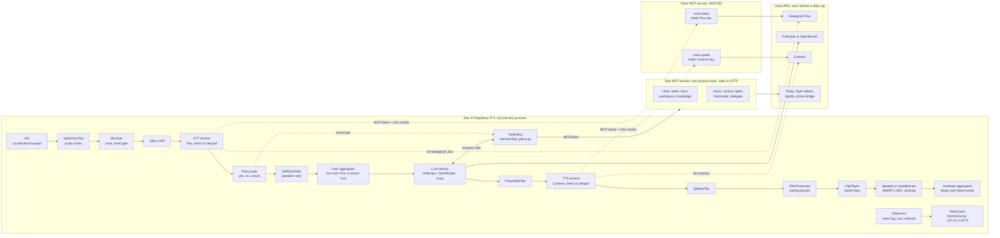

# ME3 codebase guide

How the code is laid out, how one spoken turn moves through it, and the pieces of code that matter most. Current as of Nov 5, 2026 (main after PR 1, plus ADR-041 and ADR-042).

For design reasons read `docs/architecture.md` and the ADRs in `docs/decisions/`. For tools and guardrails read `docs/tools.md`. To run it, read `docs/quickstart-mac.md`.

## The short version

ME3 is one Python process, `harness/bot.py`, that builds a Pipecat 1.13 pipeline. The pipeline listens on the mic, detects speech with Silero, turns speech into text with Deepgram Flux, asks an LLM (Claude Haiku 5.5 by default), and speaks the reply with Cartesia. Only VAD, Smart Turn, echo cancelling, and audio I/O run locally.

Everything the LLM can do is an MCP tool on one of ten task servers, each its own process. The harness wraps every tool in a policy that can run it, hold it for an undo window, or ask the user first.

Speech recognition and speech output can also go through two MCP voice servers (`voice-listen`, `voice-speak`). They hold the provider keys and connections. MCP carries control and events, and the audio itself rides a local Unix socket.

Every stage defaults to a free fake. A real provider runs only when a run selects it, its key is in `.env`, and its daily cap in `configs/providers.yaml` is above zero.

## Architecture diagram



Dotted STT and TTS lines show the two ways to reach the providers. `stt=deepgram_flux,tts=cartesia` connects from the harness. `stt=voice_listen,tts=voice_speak` goes through our voice servers, so the harness never holds those keys. Both use the same Pipecat services above the socket.

`docs/diagrams/*.svg` are drawings from Oct 22, before most of this was built. Treat them as history.

## Folder layout

```
harness/            the voice agent process
  bot.py            entry point: CLI flags, builds and runs the pipeline, agent loop
  config.py         loads configs/<profile>.yaml, providers.yaml, tool_policy.yaml
  providers.py      build_stt, build_llm, build_tts: fake or real, cap checked first
  fakes.py          ScriptedSTT, RuleBasedLLM, tone and word-timestamp TTS fakes
  mcp_tools.py      starts task servers, decides which secrets each one gets
  tool_policy.py    ToolPolicy and PolicyGate: run, hold, ask, refuse
  voice_bridge.py   VoiceMCPBridge: raw MCP ClientSession that receives voice events
  voice_relay.py    RelayedConnection: Pipecat's Flux and Cartesia over our voice servers
  audio_io.py       device selection by name, the speaker safety check
  echo_cancel.py    WebRTC AEC in the harness (ADR-013)
  ducking.py        duck-then-decide barge-in prototype (ADR-007, off by default)
  addressing.py     MicGate, level gate, ACTIVE and IDLE, stay_silent (ADR-016, off)
  filler.py         rotating waiting phrase (ADR-033)
  preamble.py       drops a waiting phrase the model says before a tool call (ADR-041)
  self_echo.py      SpokenTap and SelfEchoFilter: ignore the bot's own words on speakers (ADR-042)
  phrase_cache.py   loads the stored clips in assets/fallback_wavs/
  recovery.py       spoken fallback when the LLM errors
  network.py        TCP probes and the network_lost clip (ADR-037)
  events.py         EventLog (logs/events-<run>.jsonl) and TurnEventObserver
  audio_marks.py    sample-level marks for the headline latency (ADR-036)
  audio_hops.py     audio hop timing for the voice servers
  costs.py          CostObserver: usage frames into the cost ledger
  agents.py         agents from configs/agents.yaml and data/agents (ADR-039)
  ui.py             robot face web server; ui_page.html and ui_spotify.js are the page
  timer_watch.py    says a due timer or alarm aloud
  delegate_watch.py reports a finished background task
  file_input.py     wav input mode, paced 20 ms frames
  null_output.py    output for wav and test runs, paced like a real device
servers/            MCP servers, one process each
  common.py         ToolCallLog middleware, data_dir, tool_stage, serve()
  voice_relay.py    shared core of the voice servers: upstream socket, Unix socket relay
  voice_events.py   emit(): voice events as MCP logging notifications (ADR-008)
  voice_listen/     server.py (Flux), stub_server.py (for the bridge probe)
  voice_speak/      server.py (Cartesia), stub_server.py
  command_policy.py what bash may run at once, what must ask (ADR-034)
  sandbox.py        sandbox-exec on the Mac, bwrap on the Pi
  documents.py      document parsing for the docs server
  tasks/<name>/     clock, notes, docs, workspace, knowledge, music, comms,
                    lights, thermostat, delegate
bench/              tools to check, measure, and debug; all free unless noted
configs/            mac.yaml, pi.yaml, providers.yaml, tool_policy.yaml, agents.yaml
scripts/            pi_setup.sh, pi_kiosk.sh, systemd/, mac_phone_bridge.py, pipewire_aec.conf
assets/             fallback_wavs/ (stored clips), sample_documents/ (fictional)
tests/              pytest, all on fakes; tests/test_live.py needs ME3_LIVE=1
data/, logs/        local state and event logs, never in git
```

## How one turn flows

1. **Mic in.** `LocalAudioTransport` reads 16 kHz audio from the device named in the profile. On speakers, WebRTC AEC removes the bot's own voice first.
2. **Mute and VAD.** `MicGate` drops every frame while muted, before anything reaches the cloud. Silero marks speech start after about 80 ms (`vad.start_secs`).
3. **Speech to text.** Flux streams transcripts and also decides end of turn. With a non-Flux STT, Smart Turn v3 decides instead (`turn.stop: auto`, ADR-005).
4. **PolicyGate and SelfEchoFilter.** If an action is held, a short "yes" or "cancel" is answered here by the harness with no LLM call. On speakers, a transcript that cut the bot off and repeats three or more of its recent words in order is dropped as echo.
5. **LLM.** The user aggregator adds the turn to the context and the LLM streams a reply. Tool calls go to `ToolPolicy`, which calls the MCP server or holds the call.
6. **PreambleFilter.** If the model starts with "let me check" and then calls a tool, that sentence is dropped, since the device already plays a waiting phrase.
7. **Text to speech.** Cartesia speaks sentence by sentence (`TextAggregationMode.SENTENCE`) and returns word timestamps.
8. **Waiting phrase and clips.** If no reply audio arrives within 1500 ms, or a slow tool starts, a stored clip plays. Network-loss and spending-cap clips also play from here.
9. **Speaker out, then context.** On barge-in, Pipecat stops the LLM and TTS and flushes the audio. The assistant aggregator commits only the words that were heard.

Observers watch every frame and change nothing: `TurnEventObserver` writes the event log, `CostObserver` meters usage into the ledger and stops the bot at a cap, and `NetworkWatch` starts probes after a provider error. The face reads the same events.

## Key code

The excerpts below are trimmed with `...`. Each names its file and function so it can be found.

### The pipeline (`harness/bot.py`)

The whole agent is this list. `front` changes with the input mode (mic, wav, or text). The rest is the same for every run.

```python
# harness/bot.py, run_bot()
if input_mode == "mic":
    transport = local_transport(audio, audio_out_filter=duck_gain, on_event=log.emit)
    OutputVoiceTap(log.emit).attach(transport.output())      # headline latency marks (ADR-036)
    stt = build_stt(cfg.providers, ledger, interrupt=stt_interrupts, forced=forced, voice=voice)
    front = [transport.input(), InputVoiceTap(log.emit, adaptive=True), mic_gate, _vad(cfg), stt,
             gate, *echo_procs, *address_procs, *duck_procs]
    back = [*filler_procs, clips, transport.output()]
...
pipeline = Pipeline(
    [*front, aggregators.user(), llm, PreambleFilter(log.emit), tts, *tap_procs, *back,
     aggregators.assistant()]
)
worker = PipelineWorker(
    pipeline,
    params=PipelineParams(audio_in_sample_rate=..., audio_out_sample_rate=...,
                          enable_metrics=True, enable_usage_metrics=True),
    observers=[turn_obs, cost_obs, *([network] if network else [])],
    idle_timeout_secs=None,
)
```

Turn detection uses Pipecat 1.x `user_turn_strategies`, never the removed interruption arguments. With Flux the strategies are left as `None`, so Pipecat applies the ones Flux recommends:

```python
# harness/bot.py, _turn_strategies()
if mode == "flux":
    return None                      # Flux owns start and end of turn (ADR-005)
if mode == "smart_turn":
    stop = [TurnAnalyzerUserTurnStopStrategy(turn_analyzer=LocalSmartTurnAnalyzerV3())]
...
interrupt = cfg.profile["barge_in"]["mode"] == "immediate"
return UserTurnStrategies(
    start=[VADUserTurnStartStrategy(enable_interruptions=interrupt),
           TranscriptionUserTurnStartStrategy(enable_interruptions=interrupt)],
    stop=stop,
)
```

### Tools reach the LLM through the policy (`harness/bot.py`, `harness/tool_policy.py`)

The bot starts the task servers, lists their tools, and hands the LLM only the wrapped versions:

```python
# harness/bot.py
async with task_clients(mcp_transport, data_dir, servers, doc_scope) as clients:
    tools = await policy.tools(clients)
    if doc_scope is not None:   # a document agent sees its read tools and nothing else
        tools = ToolsSchema(standard_tools=[t for t in tools.standard_tools if t.name in DOCUMENT_TOOLS])
    context = LLMContext(tools=tools)
    ...
    llm.register_function(None, policy.deny_unknown)   # disabled or invented tools stop here
```

`ToolPolicy.tools` merges every server's tools, refuses duplicate names before anything runs, builds a rule from the MCP hints plus `configs/tool_policy.yaml`, and swaps each handler for a `PolicyHandler`:

```python
# harness/tool_policy.py, ToolPolicy.tools()
for server, (schema, hints) in zip(clients, listed, strict=True):
    for tool in schema.standard_tools:
        if tool.name in owners:
            raise DuplicateToolName(f"{tool.name!r} is on both {owners[tool.name]} and {server}")
        rule = default_rule(tool.name, hints.get(tool.name), self._cfg["defaults"])
        rule = apply_override(rule, overrides.get(tool.name))
        if rule.permission == "disabled":
            continue                                   # never shown to the model
        kept.append(FunctionSchema(name=tool.name, description=tool.description,
                                   properties=tool.properties, required=tool.required,
                                   handler=PolicyHandler(self, rule, tool.handler)))
```

Every call then lands in `handle`, which decides what happens:

```python
# harness/tool_policy.py, ToolPolicy.handle()
if self.contained and rule.name in self._contain_tools:
    ...  # three critical refusals lock shell and messaging for the session
warning = await self._guarded(rule, params, args)   # bash: servers/command_policy.py
if warning is RUN_NOW:                               # a plain read such as ls
    await self._answer(rule, params, await self._call(rule, inner, params))
elif rule.permission == "confirm":
    await self._hold(rule, inner, params, "confirm", warning)   # read-back, then a spoken yes
elif rule.undo_s > 0:
    await self._hold(rule, inner, params, "undo")               # "say cancel in 5 seconds"
elif rule.read_only:
    await self._answer(rule, params, await self._call(rule, inner, params))
else:
    await self._protected_commit(rule, inner, params)           # finishes even on barge-in
```

A held call answers the LLM at once with `waiting_for_undo` or `needs_confirmation`, so the mic stays open. Only a later transcript can release it. A confirm tool with a `readback` is read aloud from its real arguments by the harness, not by the model:

```yaml
# configs/tool_policy.yaml
tools:
  send_message:
    timeout_s: 25.0
    readback: "Send {to} this message: {body}. Should I send it?"
  bash:
    guard: command    # reads run at once; changes and runs ask (ADR-034)
    readback: "This will {command_words}. Should I go ahead?"
```

The robot face uses the same policy. A tap can run only a screen tool that would run at once anyway:

```python
# harness/tool_policy.py, ToolPolicy.run_from_screen()
if not self._runs_from_screen(name) or not SCREEN_TOOLS[name](args):
    self._decide(name, "denied_screen", args=args)
    return {"status": "denied", "reason": "not available from the screen"}
```

### A task MCP server (`servers/tasks/clock/server.py`)

Each server is a small FastMCP app. Every tool carries all four hints, and `ToolCallLog` writes each call to `data/tool_calls.jsonl`:

```python
mcp = FastMCP("clock", instructions="Timers and alarms. Durations are in seconds; ...")
mcp.add_middleware(ToolCallLog("clock"))

@mcp.tool(annotations={"readOnlyHint": True, "destructiveHint": False,
                       "idempotentHint": False, "openWorldHint": False})
def get_time() -> dict:
    """Get the current local date and time. Always use this for the time or date; never guess."""
    ...

@mcp.tool(annotations=WRITE)
def set_timer(
    duration_seconds: Annotated[int, Field(gt=0, le=86400, description="Timer length in seconds")],
    label: str = "",
) -> dict:
    """Start a countdown timer."""
    return _add("timer", time.time() + duration_seconds, label)
```

Pydantic `Field` limits are checked by the server whatever the model sends. Run any server alone with `uv run python -m servers.tasks.clock.server` (stdio) or add `--transport http --port 8765`.

### Starting servers, and who gets which secret (`harness/mcp_tools.py`)

Each server starts with every `*_API_KEY` removed from its environment, except the one it needs:

```python
TASK_SERVERS = {"clock": ..., "notes": ..., "thermostat": ..., "comms": ..., "lights": ...,
                "music": ..., "knowledge": ..., "docs": ..., "workspace": ..., "delegate": ...}
SERVER_KEYS = {
    "servers.tasks.knowledge.server": {"TAVILY_API_KEY"},
    VOICE_SERVERS["listen"]: {"DEEPGRAM_API_KEY"},
    VOICE_SERVERS["speak"]: {"CARTESIA_API_KEY"},
    TASK_SERVERS["delegate"]: {"ANTHROPIC_API_KEY"},
}

def _server_env(data_dir, module="", extra=None):
    allowed = SERVER_KEYS.get(module, set())
    env = {k: v for k, v in os.environ.items() if not k.endswith("_API_KEY") or k in allowed}
    if module != TASK_SERVERS["music"]:   # Spotify credentials reach only music
        env = {k: v for k, v in env.items() if not k.startswith("SPOTIFY_")}
    if module != TASK_SERVERS["comms"]:   # the bridge token reaches only comms
        env.pop("ME3_PHONE_BRIDGE_TOKEN", None)
    env.pop("ME3_DOC_SCOPE", None)        # set only by a document agent, never inherited
    ...
```

`task_clients` opens one Pipecat `MCPClient` per server over stdio or streamable HTTP (`--mcp http` starts each server on a free loopback port). A document agent passes `ME3_DOC_SCOPE` to the docs server only, and the server enforces it:

```python
# servers/tasks/docs/server.py
def scope() -> list[Path] | None:
    raw = os.environ.get("ME3_DOC_SCOPE", "").strip()
    if not raw:
        return None                      # the generalist sees every document
    base = documents_dir().resolve()
    for item in filter(None, (i.strip() for i in raw.split(","))):
        target = (base / item).resolve()
        if not target.is_relative_to(base):
            raise ScopeError(f"{item} is outside the documents folder")
```

### The voice servers (`servers/voice_speak/server.py`, `servers/voice_relay.py`)

A voice server is a FastMCP app around a shared `Relay`. Its upstream address is fixed, and only a query string comes from the harness, so a caller cannot point the key anywhere else:

```python
# servers/voice_speak/server.py
relay = Relay("voice-speak", Upstream(
    provider="cartesia",
    url="wss://api.cartesia.ai/tts/websocket",
    env_key="CARTESIA_API_KEY",
    auth=lambda key: {"X-API-Key": key},
    test_env="ME3_VOICE_SPEAK_UPSTREAM",
    events=_FirstChunk(),                 # audio_started, audio_done, tts_error
    headers=frozenset({"Cartesia-Version"}),
))

@mcp.tool(annotations={**CONTROL, "idempotentHint": False})
async def speak(ctx: Context, query: str = "", version: str = "") -> dict:
    """Open a Cartesia stream; stays open until the stream closes."""
    return await relay.open(ctx, query, {"Cartesia-Version": version} if version else None)
```

`Relay.open` checks the cap, connects to the provider, then offers the stream on a private Unix socket. The MCP call stays open for the life of the stream, which is what lets the server send events (ADR-008):

```python
# servers/voice_relay.py, Relay.open()
url = self._url(query)
self._ledger().authorize(self._up.provider)          # a zero or spent cap refuses here
key = os.environ.get(self._up.env_key, "")
...
sid = secrets.token_hex(4)
session = _Session(sid, self._dir / f"{sid}.sock", secrets.token_hex(16))
ws = await self._connect_upstream(session, url, {**self._up.auth(key), **extra})
if ws is not None:
    await self._offer(ctx, session, ws)              # relay both ways until either end closes
await emit(ctx, "stream_closed", session=sid, reason=session.reason)
```

Socket frames are one kind byte (`B` binary, `T` text), a 4-byte length, then the payload:

```python
HEADER = struct.Struct(">cI")

def write_frame(writer, message):
    payload, kind = (message.encode(), b"T") if isinstance(message, str) else (bytes(message), b"B")
    writer.write(HEADER.pack(kind, len(payload)) + payload)
```

Events travel as MCP logging notifications on the `voice` logger, because the sessionless MCP protocol drops notifications that are not tied to an open request:

```python
# servers/voice_events.py
async def emit(ctx: Context, event: str, **data) -> None:
    await ctx.log(event, level="info", logger_name="voice",
                  extra={"event": event, "t_emit_ns": time.monotonic_ns(), **data})
```

### The harness end of the voice servers (`harness/voice_relay.py`, `harness/providers.py`)

The harness keeps Pipecat's own `DeepgramFluxSTTService` and `CartesiaTTSService`. A mixin replaces only the WebSocket connect, so turn events, reconnects, word timestamps, and interruption stay Pipecat's:

```python
# harness/voice_relay.py
class RelayedConnection:
    """Mixin for a Pipecat WebSocket service: its provider socket comes from a voice server."""

    async def _websocket_connect(self, uri: str, **kwargs):
        args = {"query": urlsplit(uri).query}
        if version := (kwargs.get("additional_headers") or {}).get("Cartesia-Version"):
            args["version"] = version
        return await self._relay.open(self._relay_tool, args)   # MCP speak/listen, then the socket
```

```python
# harness/providers.py, build_tts()
if choice == "voice_speak":
    class RelayedCartesiaTTSService(RelayedConnection, TimedCartesiaTTSService):
        pass
    p, relay = _relay("speak", providers_cfg, ledger, voice)
    service, key = RelayedCartesiaTTSService, "held-by-voice-speak"   # the harness has no key
```

The events come back through `VoiceMCPBridge` (`harness/voice_bridge.py`), which uses the raw MCP SDK `ClientSession` with a logging callback, because Pipecat's `MCPClient` has no notification hook. Each event becomes a `VoiceEventFrame` stamped with the local hop time.

### Spending caps (`bench/cost_ledger.py`)

Every paid call goes through the ledger. A cap of zero refuses the call, and so does a spent cap:

```python
def authorize(self, provider: str) -> None:
    cap = self.cap(provider)
    if cap <= 0:
        raise SpendRefused(f"{provider}: daily cap is zero, call refused")
    spent = self.spent_today(provider)
    if spent >= cap:
        raise SpendRefused(f"{provider}: daily cap ${cap:.2f} reached (spent ${spent:.4f})")
```

`CostObserver` records usage from Pipecat's metrics frames into `data/cost_ledger.jsonl`. When a cap is reached mid-session, the bot plays the stored `cap_reached` clip, so the notice costs nothing, and stops.

### The shell sandbox (`servers/tasks/workspace/server.py`)

`bash` is a mock unless `ME3_WORKSPACE_LIVE=1`. Live, the command has already passed the command policy in the harness, and the server runs it inside the OS sandbox with no network. With no sandbox it refuses:

```python
def bash(command: str, cwd: str = ".") -> dict:
    folder = inside(cwd, [workspace_dir()])          # refuses paths outside data/workspace
    if not _live():
        return _mock("bash", command=command, cwd=cwd)
    try:
        argv = _sandboxed(command, "none", folder)    # sandbox-exec on the Mac, bwrap on the Pi
    except NoSandbox as e:
        return {"error": str(e)}
    kept = _keep_deleted(command, folder)            # rm keeps a copy in .versions
    ...
```

### The event log (`harness/events.py`)

Every part of the harness writes to one JSON-lines file per run, stamped with one monotonic clock. The reports, the latency probe, and the face all read it:

```python
def emit(self, event: str, **fields) -> dict:
    rec = {"run_id": self.run_id, "turn_id": self.turn_id, "event": event,
           "t_ns": time.monotonic_ns(), **fields}
    self._f.write(json.dumps(rec, default=str) + "\n")
    for listener in self.listeners:       # the robot face is a listener
        listener(rec)
    return rec
```

## Configuration

| File | What it holds |
| --- | --- |
| `configs/mac.yaml`, `configs/pi.yaml` | The profile: audio devices by name, VAD, turn mode, barge-in mode, waiting phrase, addressing, network probes, face. Nothing else may differ between the two |
| `configs/providers.yaml` | Which implementation each stage uses (`stt`, `llm`, `tts`, `music`), tool backends (`search`, `weather`, `fetch`, `comms`, `delegate`), daily caps, prices, the OpenRouter model list |
| `configs/tool_policy.yaml` | Per-tool permission, undo window, timeout, read-back, guard, containment, fixed phrases |
| `configs/agents.yaml` | The generalist and five document agents, their folders, model, and colour |
| `.env` | Keys only. Never committed |

Per-run overrides, without editing files:

| Override | Example |
| --- | --- |
| `--stages` | `--stages stt=voice_listen,llm=anthropic,tts=voice_speak` |
| `ME3_TOOL_STAGES` | `ME3_TOOL_STAGES=search=tavily,comms=bridge` |
| `ME3_WORKSPACE_LIVE=1` | Real `bash`, `serve`, and `open_in_browser`, sandboxed |
| `--profile pi` | Pi devices, echo cancelling on |
| `--agent`, `--model` | One agent, one listed model, for a scripted run |
| `--flux`, `--turn-stop`, `--barge-in` | Turn and interruption tuning |

## Bench tools

All free unless marked.

| Command | What it does |
| --- | --- |
| `bench.doctor` | Health check: versions, keys present, caps, devices, models, sandbox. Run first |
| `bench.run_report` | Timeline and anomalies for one run, or `--list N` for recent runs |
| `bench.cost_ledger` | Today's spend per provider |
| `bench.latency_bench`, `bench.latency_probe` | Scripted turns, then p50, p90, p95 from audio marks (ADR-036) |
| `bench.interruption_test` | Barge-in stop time and words over-committed |
| `bench.task_runner` | Task suite on fakes, with pass rates and failure buckets |
| `bench.voice_hop_probe`, `bench.voice_bridge_probe` | Cost of the hop through the voice servers |
| `bench.echo_probe` | Echo cancelling on speakers, no cloud calls |
| `bench.eot_sweep` | End-of-turn settings sweep on fakes |
| `bench.make_phrases` | Remakes the stored clips (paid, small) |
| `bench.spotify_login` | One-time Spotify login |

## Tests

```bash
uv run pytest -q
```

Everything runs on fakes and spends nothing. Each server, the policy, the relay, the face, and the benches have their own test file in `tests/`. `tests/test_live.py` makes real calls and runs only with `ME3_LIVE=1`.

## Where to start reading

1. `harness/bot.py`, `run_bot()`: the whole pipeline in one function.
2. `harness/tool_policy.py`, the module docstring: why held actions work the way they do.
3. `servers/tasks/clock/server.py`: the smallest complete MCP server.
4. `servers/voice_relay.py` and `harness/voice_relay.py`: the two ends of a voice stream.
5. `docs/tools.md`, "Add a tool", before writing a new one.
